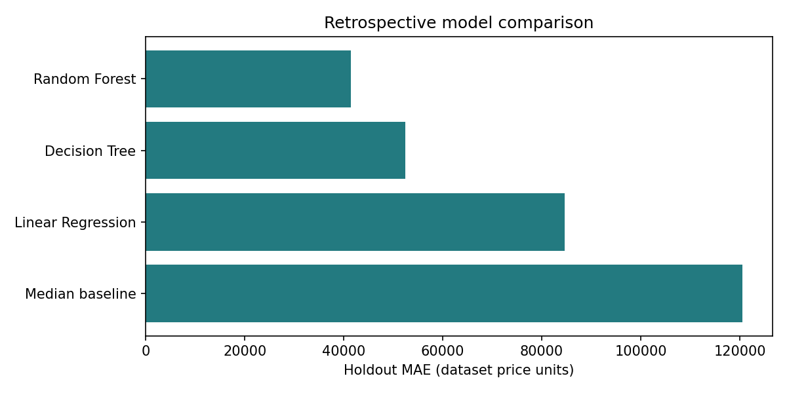

# Real Estate Price Estimation

A historical property-price modelling project with a Streamlit interface and a reproducible comparison of Random Forest, Decision Tree, and Linear Regression against a median-price baseline.

[Streamlit app](https://real-estate-price-estimation-utm6wfs9dykdimegfmmwrw.streamlit.app/) · [Training workflow](train_model.py) · [Saved evaluation](reports/baseline/metrics.csv)

## Scope and approach

The bundled, already-prepared CSV contains **1,863 records**, 14 numeric features, and sale years from **1993 to 2016**. The app explores that historical feature space. It does not provide current market-adjusted valuations. Geography, currency, source attribution, and the original preparation history are not established by the CSV and remain documentation gaps.

The comparison uses a reproducible 80/20 random holdout stratified by property type, with seed 42. All models use the same training and evaluation rows. A median-price baseline is fitted on training targets only. The feature contract checks missing/non-finite values, unexpected columns, binary flags, mutually exclusive property types, and consistency of property age.

## Reproducible results

| Model | Train MAE | Holdout MAE | Holdout RMSE | Holdout R² |
| --- | ---: | ---: | ---: | ---: |
| Random Forest | 17,612 | 41,391 | 58,782 | 0.841 |
| Decision Tree | 49,420 | 52,426 | 70,149 | 0.774 |
| Linear Regression | 86,632 | 84,660 | 107,826 | 0.466 |
| Median baseline | 123,494 | 120,524 | 149,825 | -0.031 |



These results were reproduced from the bundled CSV with scikit-learn 1.6.1. Random Forest has the lowest holdout error among these fixed candidates, with a substantial train/holdout gap that should be investigated before more complex modelling. MAE is expressed in the CSV's price units; no currency is assumed here.

[Run metadata](reports/baseline/run.json) records the input checksum, exact split indices, parameters, and package versions. [Prediction rows](reports/baseline/predictions.csv) allow independent error analysis. This is a retrospective random holdout, **not** a future-market or geographic generalization benchmark. Repeated property identities and availability of insurance/tax/listing fields at prediction time are not verified.

The root `models/` and older `figures/` artifacts predate this reproducible run and were not overwritten. In particular, the deployed app loads those older models; the table above evaluates newly fitted candidates, not the deployed artifact files. App availability has not been verified as part of this code update.

## Run locally

Use Python 3.11+ from the repository root:

```bash
git clone https://github.com/AhmedOT22/Real-Estate-Price-Estimation.git
cd Real-Estate-Price-Estimation
python -m venv .venv
# macOS/Linux:
source .venv/bin/activate
# Windows PowerShell instead: .venv\Scripts\Activate.ps1
python -m pip install -r requirements-dev.txt
streamlit run app.py
```

The serving dependency keeps scikit-learn at 1.6.1 to match the bundled model artifacts. Load pickle artifacts only from trusted sources.

## Train and evaluate

```bash
python train_model.py
# Optional: save candidate models under the report directory
python train_model.py --output reports/candidate --save-models
```

By default, evaluation writes to `reports/latest/`: `metrics.csv`, `predictions.csv`, `run.json`, and `mae_comparison.png`. It does not replace the app's model files. `--save-models` writes candidate pickles under the selected output directory, allowing comparison before any deployment change. Importing `train_model` no longer starts training or writes artifacts.

The evaluation uses fixed model choices, without holdout tuning. Check performance on a separate validation scheme before adopting new hyperparameters. Original tree-diagram utilities remain in `src/models/visualization.py`; a single tree diagram does not explain the entire forest.

## Inputs and inference

The prepared table uses `price` as target and:

- `year_sold`, `property_tax`, `insurance`, `beds`, `baths`, `sqft`, `year_built`, `lot_size`;
- binary `basement`, `popular`, `recession`;
- `property_age = year_sold - year_built`;
- one-hot `property_type_Bunglow` and `property_type_Condo` (the stored spelling is retained for model compatibility).

The app displays “Bungalow” while preserving the artifact's feature names. Sale-year inputs stay within the observed historical period. Prediction accepts exactly one finite numeric feature row in the model's expected order; unknown form features fail explicitly instead of being silently filled with zero.

## Tests

```bash
python -m pytest -q
```

Tests cover repeatable/disjoint splits, training schema violations, single-row prediction shape and numeric validity, bundled-model loading, and storage round trips. CI runs the suite for pushes and pull requests.

## Next modelling decisions

Before claiming broader usefulness, establish source provenance and currency, check whether repeated properties need a grouped split, and evaluate a chronological split. Then consider train-only imputation/encoding for genuinely raw inputs, error analysis by property type/year/price band, and better-calibrated uncertainty. Do not infer current-market suitability from this random holdout.

[MIT License](LICENSE) · [Ahmed Ouazzani](https://github.com/AhmedOT22)
